# CitizenReady database design (ERD)

Author: Santiago Reyes
Date: 2026-10-27
Last updated: 2026-11-10 (migrations 012 to 018, 2008 seed, English test tables)
Status: living document. Update it in the same PR as any migration that changes the schema.

This is the full planned schema for release one, taken from the PRD ("Data model and security rules"). Read it before writing the next migration. The migration files in `supabase/migrations/` are the source of truth for what actually exists. This file shows what is planned.

## Diagram

```mermaid
erDiagram
    AUTH_USERS ||--|| PROFILES : "has one (BUILT 001)"
    AUTH_USERS ||--|| USER_SETTINGS : "has one (BUILT 002)"
    AUTH_USERS ||--o{ PRACTICE_ATTEMPTS : "takes"
    AUTH_USERS ||--o{ USER_QUESTION_PROGRESS : "has mastery for"
    AUTH_USERS ||--o{ SRS_CARDS : "has review cards"
    AUTH_USERS ||--o{ ENGLISH_TEST_ATTEMPTS : "takes"
    PRACTICE_ATTEMPTS ||--o{ PRACTICE_ATTEMPT_ANSWERS : "contains"
    CIVICS_QUESTIONS ||--o{ PRACTICE_ATTEMPT_ANSWERS : "is answered in"
    CIVICS_QUESTIONS ||--o{ USER_QUESTION_PROGRESS : "is tracked by"
    CIVICS_QUESTIONS ||--o{ SRS_CARDS : "is scheduled by"

    AUTH_USERS {
        uuid id PK "managed by Supabase Auth"
        text email
    }

    PROFILES {
        uuid id PK "same as auth user id"
        text full_name
        text preferred_language "en es zh ar fr"
        boolean is_admin "client can never change this"
        timestamptz created_at
    }

    USER_SETTINGS {
        uuid user_id PK "FK to auth users"
        integer test_version "2008 or 2025, chosen at signup or in settings"
        boolean special_consideration "65/20, BUILT 013"
        date filing_date "optional, not used to pick the test yet"
        timestamptz updated_at
    }

    CIVICS_QUESTIONS {
        uuid id PK
        integer test_version "2008 or 2025, both are loaded"
        integer question_number "unique per test version"
        text question_text
        text_array accepted_answers "any one is enough, hidden from clients"
        integer required_count "how many answers it asks for"
        text category
        boolean is_65_20 "starred question"
        text answer_kind "fixed, current_official or by_location"
        boolean is_active
    }

    PRACTICE_ATTEMPTS {
        uuid id PK
        uuid user_id FK
        text mode "category, practice_exam, review, passed, mock_test"
        integer test_version
        integer question_count "set at start, finishes the attempt"
        timestamptz started_at
        timestamptz completed_at "null until last answer"
        numeric score_percent
        boolean passed
    }

    PRACTICE_ATTEMPT_ANSWERS {
        uuid id PK
        uuid attempt_id FK
        uuid question_id FK
        text typed_answer
        text input_mode "typed or spoken"
        boolean is_correct "set by the server only"
        text graded_by "rule or ai"
        integer response_time_ms
        timestamptz answered_at
    }

    USER_QUESTION_PROGRESS {
        uuid user_id PK "composite key with question_id"
        uuid question_id PK
        integer times_seen
        integer times_correct
        boolean_array recent_results "last 5 results, oldest first, drives mastery"
        numeric mastery_score "recency weighted"
        timestamptz last_seen_at
    }

    SRS_CARDS {
        uuid user_id PK "composite key with question_id"
        uuid question_id PK
        timestamptz due
        numeric stability "FSRS"
        numeric difficulty "FSRS"
        integer scheduled_days
        integer learning_steps
        integer reps
        integer lapses
        integer state "FSRS state"
        timestamptz last_review
    }

    ENGLISH_TEST_SENTENCES {
        uuid id PK
        text test_type "reading or writing"
        text text "unique per test_type"
        boolean is_active
    }

    ENGLISH_TEST_ATTEMPTS {
        uuid id PK
        uuid user_id FK
        text test_type "reading or writing"
        uuid_array sentence_ids "sentences already given, max 3, no repeats"
        integer sentences_correct "0 or 1, the test stops at the first correct one"
        boolean passed "null until done, true on the first correct sentence, false after 3 wrong"
        timestamptz started_at
        timestamptz completed_at "null until the test ends"
    }

    SITE_RESOURCES {
        text key PK "for example word bank file URLs"
        text value
        timestamptz updated_at
    }
```

`ENGLISH_TEST_SENTENCES` and `SITE_RESOURCES` have no foreign keys. They are lookup tables. The API grades an English test by sentence ID, so it never needs a join from attempts.

## What is built and what is planned

| Migration | What it does | Status |
|---|---|---|
| 001_create_profiles_table | profiles, RLS, grants | built |
| 002_create_user_settings_table | user_settings, updated_at trigger, RLS | built |
| 003_add_new_user_trigger | signup creates profile and settings (replaced by 012, then 013) | built |
| 004_create_civics_questions_table | question bank. 128 rows of the 2025 test in `seed.sql` (8 inactive) and 100 rows of the 2008 test in `seed_2008.sql` (10 inactive), see below | built |
| 005_create_practice_attempts_table | quiz sessions, RLS select own | built |
| 006_create_practice_attempt_answers_table | one row per answer | built |
| 007_create_user_question_progress_table | per-user mastery, `recent_results` is `boolean[]` | built |
| 008_create_srs_cards_table | FSRS review state | built |
| 009_add_question_count_to_practice_attempts | how many questions a quiz has, so the attempt can finish itself | built |
| 010_create_start_attempt_function | creates an attempt, service role only | built |
| 011_create_record_answer_function | writes answer and progress, finishes the attempt (60% to pass), one transaction | built |
| 012_read_test_version_at_signup | signup reads `test_version` (2008 or 2025) from the new user's metadata, default 2025 | built |
| 013_add_special_consideration | adds `user_settings.special_consideration` (65/20), user can update it, signup can set it | built |
| 014_update_record_answer_for_fsrs | extends record_answer to update the FSRS card and recency mastery | planned, Phase 3 |
| 015_create_english_test_sentences_table | sentence bank, rows loaded by `seed_english.sql` (generated from `api/src/english/sentences.ts`) | built |
| 016_create_english_test_attempts_table | one row per reading or writing test, RLS select own | built |
| 017_create_start_english_attempt_function | opens a test, service role only | built |
| 018_create_record_english_answer_function | records one sentence and ends the test by the USCIS rule (first correct passes, 3 wrong fail), service role only | built |
| 019_create_site_resources_table | word bank URLs and settings | planned, Phase 4 |
| 020_create_word_bank_storage_bucket | Storage bucket and admin-only upload policy | planned, Phase 4 |

Numbers after 013 are provisional. A migration gets its final number when it is written, in the order we build them.

Phase 3 adds a new migration (014) that replaces the `record_answer` function. We never edit an existing migration, so 011 stays as it is. Migrations 012 and 013 did the same for `handle_new_user`: each replaced the previous version in a new file.

## Security rules every migration must follow

1. Turn on RLS for a table in the same migration that creates it.
2. `civics_questions` and `english_test_sentences`: signed-in users can read, nobody can write from the client.
3. `profiles` and `user_settings`: a user reads and updates only their own row, and only the safe columns. `is_admin` is never updatable.
4. Attempts, answers, progress, review cards, English attempts: users get SELECT on their own rows only. No INSERT, UPDATE or DELETE for clients.
5. All writes to those tables happen inside Postgres functions (`start_attempt`, `record_answer`, `start_english_attempt`, `record_english_answer`). Revoke EXECUTE on them from `anon` and `authenticated` and grant it to `service_role` only. The Express API calls them with the secret key after checking the session itself.
6. The `/quiz/start` response must never include official answers.
7. Supabase grants tables broadly by default, so every migration revokes that first and grants back only what is needed (see 001).

## Conventions

These come from the EnergyAI contributing guide, section 5, with the changes noted below.

- File name: `<3-digit sequence>_<short_description>.sql`, lowercase with underscores. Never reuse or reorder numbers.
- Header block on every file: migration name, author, date, description.
- Sections `-- UP (apply this migration)` and `-- DOWN (undo this migration, for rollback reference)`. The DOWN part is commented out.
- One change per file. Never edit an existing migration, add a new one.
- Include the migration in the PR that needs it.

Differences from the EnergyAI guide, on purpose:

- **Audit columns and soft deletes:** EnergyAI requires `createdOn`, `updatedOn`, `createdBy`, `updatedBy` and `isActive` on every table, and forbids deleting rows. CitizenReady does not copy that. The PRD requires a real "delete my account and all related rows" feature (privacy), so user data is hard-deleted through `on delete cascade`. Content tables that admins retire use `is_active`.
- **Naming:** Postgres convention here (snake_case tables and columns, plural table names) instead of the SQL Server PascalCase and camelCase style.

## Open questions

- Eight 2025 questions are seeded inactive with empty answers: Q30, 38, 39, 57 (`current_official`: Speaker, President, Vice President, Chief Justice) and Q23, 29, 61, 62 (`by_location`: senator, representative, governor, state capital). Ten 2008 questions are inactive the same way: Q28, 29, 39, 40, 46, 47 (`current_official`, the 2008 list also sends "how many justices" to the USCIS updates page) and Q20, 23, 43, 44 (`by_location`: senator, representative, governor, state capital). Decide later how to serve them (admin-edited names, state picker).
- The seed keeps USCIS wording. Text in (parentheses) is optional, so the Phase 2 grader must expand it.
- Both tests are loaded: `seed.sql` (2025, 128 questions) and `seed_2008.sql` (2008, 100 questions). Each has exactly 20 starred (`is_65_20`) questions. A user on 65/20 studies only those, and the real test asks 10 of them and needs 6, for either version.
- The English test pass rule comes from the USCIS scoring guidelines: the applicant must read one of up to three sentences correctly, and write one of up to three correctly, and the officer stops at the first correct one. Reading is graded on content words (short function words may be skipped) and writing allows spelling and punctuation errors that do not hide the meaning. `record_english_answer` follows that, not "two passes in a row".
- Decided: the English sentence bank lives in the `english_test_sentences` table so an admin can edit sentences without a deploy. `sentences.ts` stays as the checked source for `seed_english.sql`. The API caches the bank in memory for 5 minutes.
- Decided: no per-sentence table for English tests. The attempt row keeps `sentence_ids` so a sentence is never repeated in one test.
- Which default `test_version` do new users get? Currently 2025, unless sign-up sends 2008. `filing_date` is stored but nothing reads it yet. Either use it to suggest the test (filed before 2025-10-20 means 2008) or drop the column.
